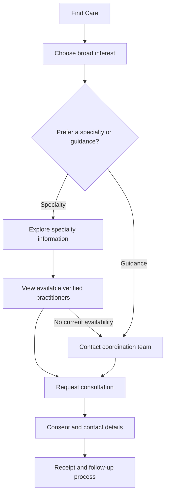

# AYUDISHA — WEBSITE MASTER BUILD SPECIFICATION

**Version:** 1.0 | **Date:** 24 November 2026 | **Status:** Ready for implementation review  
**Purpose:** A complete product, design, content and engineering brief to give to Claude Fable 5.2 or another coding agent.  
**Target:** A premium, responsive, production-ready public marketing and practitioner discovery website for AyuDisha.

---

## 1. Project instructions for the coding agent

Act as a senior product designer, frontend engineer and full-stack web architect. Build AyuDisha from this specification. Preserve the brand identity, information architecture, approved copy and contact information. Implement the MVP first, using completed reusable components and real functionality where specified; do not silently invent business data, practitioners, reviews, accreditations, prices, credentials or appointment availability.

1. Inspect the existing repository, if any, before changing it. Reuse working infrastructure and conventions. If it is empty, initialize the recommended stack below.
2. Create a visually exceptional, custom-designed website rather than a generic template. Start with the design tokens, brand lockup, navigation and homepage; then implement remaining routes and functional enquiry flows.
3. Keep the public site usable on mobile, tablet and desktop. Use realistic, licensed or clearly illustrative photography and the approved new logo assets.
4. Centralize site configuration, practitioner data, therapy data and contact information. Do not hardcode the same details on multiple pages.
5. Build public-safe demo states, accessible forms, validation, meaningful empty/error/loading states, and accurate page metadata. Test the implemented flows before declaring completion.
6. Do not publish or alter DNS, payment credentials, live practitioner listings or customer data without the owner's authorization. Deliver a preview and deployment instructions.

## 2. Brand and official business information

| Field | Approved value |
|---|---|
| Brand display name | AyuDisha |
| Wordmark | AYUDISHA |
| Telugu transliteration | ఆయుదిశ |
| Hindi transliteration | आयुदिशा |
| Tagline | Your Path to Natural Wellbeing. |
| Website | https://www.ayudisha.in/ |
| Canonical host | https://www.ayudisha.in (configure HTTPS and redirect alternate host once owner authorizes DNS) |
| Email | ayudishaservices@gmail.com |
| Telephone | +91 63023 85910 |
| Telephone link | `tel:+916302385910` |
| Email link | `mailto:ayudishaservices@gmail.com` |
| Instagram | [@ayudishaservices](https://www.instagram.com/ayudishaservices/) |
| Facebook | [AyuDisha Facebook page](https://www.facebook.com/profile.php?id=61596925258577) |
| Market | India-first; do not imply national or local practitioner availability until confirmed |
| Business category | Digital holistic healthcare discovery and care-navigation platform |

The domain is already owned by the founder. Official phone, email and social links must remain exactly as supplied. The phone number's WhatsApp Business status has not been confirmed. Show a WhatsApp CTA only after the owner verifies that the number supports it; if verified, the generic enquiry link is `https://wa.me/916302385910?text=Hello%20AyuDisha%2C%20I%20would%20like%20to%20know%20more%20about%20your%20services.` Do not put patient symptoms or personal data into prefilled messages or URLs.

Physical address, legal entity name, registration details, opening hours and pricing have not been supplied. Keep them in optional configuration fields; do not publish guessed values. Use **AyuDisha** as the public brand; legal policies must be finalized with the actual operator's details before launch.

## 3. Brand purpose, motto, vision and mission

### Meaning of the name

**Ayu** means life or lifespan; **Disha** means direction. AyuDisha expresses guidance on a person's journey towards wellbeing.

### Motto

**One platform. Many paths to wellbeing.**

### Tagline (primary, on website and logo)

**Your Path to Natural Wellbeing.**

### Vision

To make it easier for people to discover and access qualified practitioners across holistic and complementary healthcare disciplines, creating a trusted starting point for personalized care and wellbeing.

### Mission

Connect individuals seeking Ayurveda, physiotherapy, chiropractic care, naturopathy and other suitable complementary services with appropriately qualified practitioners through a simple digital journey: discover, understand, connect and consult.

### Brand promise

Clear information, respectful guidance, accessible practitioner discovery and patient-centered service coordination. AyuDisha helps users explore care options; practitioners determine the appropriate clinical assessment, treatment and follow-up within their scope of practice.

### Values

- Trust: accurate information and transparent practitioner credentials.
- Compassion: acknowledge people’s individual needs and preferences.
- Accessibility: simple navigation, readable language and mobile-first access.
- Choice: help people understand available disciplines and their limitations.
- Responsibility: support appropriate clinical referrals and avoid misleading health claims.

### Positioning and scope

AyuDisha is a one-stop discovery and coordination platform for holistic, traditional and complementary care, not a replacement for emergency services, medical diagnosis or necessary conventional medical care. The founder's business preference is to focus on disciplines outside conventional medical practice; communicate that specialty positively without disparaging conventional medicine or encouraging users to discontinue prescribed treatment. Physiotherapy is an established healthcare discipline, not merely a natural remedy. Never describe every listed therapy as effective for every condition.

## 4. Audience and business goals

**Primary users:** People who want to explore complementary care, obtain guidance on clinician discovery, find physiotherapy or movement-related care, seek an Ayurveda or naturopathy consultation, or understand healthcare options without already knowing which discipline to select.

**Secondary users:** Family members coordinating care; qualified practitioners interested in joining AyuDisha; referral partners and wellness communities.

**Primary business conversion:** A genuine patient enquiry or consultation request. Secondary conversions: therapy exploration, practitioner profile views, practitioner onboarding enquiries, calls and email clicks. Do not invent conversion metrics or guaranteed results. The goal is qualified enquiries and transparent, reliable service coordination.

## 5. Visual identity and exact asset handoff

### Approved new identity

Use the latest emblem: open circular arc, moving human figure, upward-facing leaf and flowing path. Its meaning is life, nature, movement and direction. The earlier logo with a prominent spine represents a superseded concept and must not be used as the main site identity.

Download the following approved reference assets and put them in `public/brand/` or `public/campaign/`. The source files are available in the owner's ChatGPT Library. Supply the downloaded files to the external coding agent with this specification; do not assume that Claude has access to private Library links.

| Source asset | Intended use | Suggested filename |
|---|---|---|
| [AyuDisha Holistic Healthcare Brand Mark](https://chatgpt.com/library?file_id=libfile_851b7d98df448191ab1da9cf531733b6&account_id=personal) | Transparent full logo lockup | `brand/ayudisha-logo.png` |
| [Flowing human and leaf emblem](https://chatgpt.com/library?file_id=libfile_2951c3be10208191805f9f547057f50a&account_id=personal) | Icon, avatar and favicon source | `brand/ayudisha-icon.png` |
| [A New Direction for Wellbeing](https://chatgpt.com/library?file_id=libfile_4bfe28d96de08191bf307a39067b7cc4&account_id=personal) | Introduction campaign reference | `campaign/introduction.png` |
| [Premium holistic care services poster](https://chatgpt.com/library?file_id=libfile_236b1c477de88191bb9fbcde58ddb3b5&account_id=personal) | Services campaign reference | `campaign/services.png` |
| [Your next step starts here](https://chatgpt.com/library?file_id=libfile_1548cdf3863c8191ad8eabcdf5717625&account_id=personal) | Consultation CTA reference | `campaign/connect.png` |

Use artwork references to recreate the visual language, not as a homepage screenshot or text-heavy hero image. Use real HTML headings and text. Generate accessible raster variants (WebP/AVIF as appropriate) and favicon sizes from the actual approved icon. The PNG is not an SVG; do not misrepresent it as a vector file. A production SVG can be commissioned or traced and reviewed separately. Keep the logo's original proportions and clear space; verify visual quality at 24, 40, 64 and 160 px; use the icon alone in small spaces.

### Design tokens

| Token | Hex / font | Usage |
|---|---|---|
| `brand-primary` | `#234C3D` | Main CTA, dark sections, emphasis |
| `brand-dark` | `#19382D` | Darker hover, strong text, footer |
| `brand-sage` | `#91B49A` | Accent, soft surfaces, botanical detail |
| `brand-ivory` | `#FAF8F2` | Overall page background |
| `brand-gold` | `#C4A36B` | Decorative accents, thin dividers |
| `brand-text` | `#24352D` | Reading text |
| `brand-muted` | `#57675D` | Secondary text |
| `brand-surface` | `#FFFFFF` | Cards and forms |
| `brand-border` | `#E0E6DC` | Separators and form outlines |
| Heading font | Cormorant Garamond or locally hosted equivalent | Large editorial serif headers |
| Body/UI font | Manrope or locally hosted equivalent | Navigation, paragraphs, forms |

Gold and sage are largely decorative; use high-contrast dark green text on ivory for accessible reading. Provide a readable serif fallback and sans-serif fallback. Avoid overly thin text, especially on mobile. Use a light theme as default, not a dark dashboard aesthetic.

### Art direction

Premium Indian wellness meets modern healthcare: warm sunlight, natural timber, ivory linen, subtle greenery, natural skin tones and uncluttered professional consultation rooms. Botanical textures may be used sparingly as decorative elements. Avoid visual clichés such as excessive leaves, glowing chakras, stock medical crosses, masses of gradients, futuristic HUDs or overwhelming gold ornamentation. Develop a consistent editorial photographic style with different compositions per page. Do not show images as actual AyuDisha clinicians or patient outcomes unless authenticated and authorized.

### Layout system

- Mobile-first fluid grid: desktop content width 1200–1320px, 24–32px horizontal margins where space permits; mobile padding 16–20px.
- Headings: hero approximately 52–76px on desktop, 36–48px on mobile; sectional headings 32–48px desktop, 28–36px mobile. Use responsive clamped sizes, with line wrapping tested.
- Body text: 16–18px, readable line-height, limited paragraph width.
- Spacing: use an 8px rhythm, with substantial section whitespace. Cards: 16–24px radii, subtle borders and restrained shadows.
- CTA: solid forest green, warm ivory text, clear hover/focus state, minimum 44px target. Secondary CTAs: outlined forest green. Do not use gold as the main text color or rely on color alone.
- Motion: subtle fade/slide transitions, optional decorative motion, respect `prefers-reduced-motion`. No autoplay sound, no excessive entrance animation, no compulsory carousels.
- Avoid floating clutter. One persistent mobile CTA or phone action is sufficient; ensure it never obscures footer consent links or content.

## 6. Site information architecture

| Route | Page / purpose | MVP |
|---|---|:---:|
| `/` | Homepage, brand, discovery and primary CTA | Yes |
| `/find-care` | Explore care based on a broad concern or specialist preference | Yes |
| `/therapies` | Overview of specialties | Yes |
| `/therapies/ayurveda` | Ayurveda details | Yes |
| `/therapies/physiotherapy` | Physiotherapy details | Yes |
| `/therapies/naturopathy` | Naturopathy details | Yes |
| `/therapies/chiropractic` | Chiropractic care details | Yes |
| `/practitioners` | Searchable practitioner directory or preview | Yes |
| `/practitioners/[slug]` | Individual profile template | Yes, demo-only until verified |
| `/consultation` | Request a consultation/contact form | Yes |
| `/about` | Mission, vision, philosophy, values | Yes |
| `/join-practitioner` | Practitioner onboarding enquiry | Yes |
| `/contact` | Verified business contacts and general enquiry | Yes |
| `/resources` | Resources landing and educational articles | Yes |
| `/resources/[slug]` | Clinically reviewed article template | Conditional; publish only after review |
| `/privacy-policy` | Privacy information | Yes, owner/legal review before public launch |
| `/terms` | Terms of service and platform scope | Yes, owner/legal review before public launch |
| `/disclaimer` | Medical scope and safety information | Yes |
| `/faq` | Frequently asked questions | Yes |
| `/thank-you` | Enquiry receipt confirmation | Yes, no personal details in URL |
| `/404` | Matched brand recovery page | Yes |
| `/patient/*`, `/practitioner/*`, `/admin/*` | Future authenticated product modules | Later |

Header navigation: Home · Find Care · Therapies · Practitioners · About Us. Primary header CTA: **Connect with AyuDisha**. On compact screens use a keyboard-accessible menu and maintain obvious access to Find Care. Footer links: all core services, Find Care, Practitioners, About Us, Join as Practitioner, Contact, FAQ, Privacy, Terms, Disclaimer, Instagram and Facebook. Footer copyright auto-updates year. Social links open official profiles, using icons with accessible names. Do not add profiles on other social networks.

## 7. Homepage — complete section-by-section specification

Build sections in this order. The patient and visitor enquiry flow is the most important UI priority. Design for one clear primary action per section.

### 7.1 Header

On ivory, present approved logo lockup left, navigation center where space allows, prominent solid forest CTA right. Make the nav sticky only if it does not eat too much mobile screen space. Header mobile menu includes phone or enquiry CTA. Logo returns to homepage. Active navigation and visible keyboard focus are required.

### 7.2 Hero: premium editorial introduction

Eyebrow: **HOLISTIC CARE. HUMAN CONNECTION.**  
H1: **A new direction for your wellbeing.**  
Description: AyuDisha connects you with qualified healthcare practitioners across Ayurveda, physiotherapy, naturopathy and chiropractic care. Discover care options, understand your next step and connect for a consultation.  
Primary CTA: **Find My Care** → `/find-care`  
Secondary CTA: **Explore Therapies** → `/therapies`

Use a two-column layout on desktop: editorial copy left, beautiful image right, an organic curved frame or arch, natural greenery and understated gold line. Photo depicts a respectful discussion with a practitioner in a premium, bright care setting; label as an illustration if used as generic photography. On mobile use headline, description, CTA and then a cropped image. No fabricated testimonial, rating, provider count or insurance endorsement.

### 7.3 Problem-based discovery

Heading: **Start with what matters to you.**  
Subheading: You don't need to know which specialty to choose. Explore a health concern or talk to our team.

Cards: Back & Neck Concerns; Joint & Muscle Concerns; Mobility & Rehabilitation; Lifestyle & Nutrition; Digestive Wellbeing; Stress & Sleep; General Wellbeing; Not Sure Where to Begin. Cards lead to `/find-care?interest=<non-sensitive-category-slug>` only if the category is generic and does not expose personal data. Prefer navigational category state; never send health concerns to advertising tools or analytics. Do not claim the selected therapy is a treatment for the condition or present an automated diagnosis.

### 7.4 Four flagship specialties

Heading: **Whole-person care. More possibilities.**  
Subheading: Explore our holistic care network.

Display four large service cards with readable titles, concise one-line summaries, photography and a Learn More link. Ayurveda: traditional approaches and practitioner-led consultation; Physiotherapy: assessment, movement and rehabilitation; Naturopathy: lifestyle and wellbeing guidance; Chiropractic Care: musculoskeletal assessment and support. Clicking opens a real therapy detail page. No medication or outcome imagery suggesting a guaranteed cure. Include an optional 'Ask about other care options' link to the enquiry page; don't advertise unavailable specialties as active services.

### 7.5 How AyuDisha works

Heading: **Your next step starts here.**  
Use three steps with restrained icons: (1) Share your concern — select a broad interest or request guidance; (2) Explore your options — understand services and suitable available practitioners; (3) Connect with a practitioner — request an appointment or speak with the coordination team. CTA: **Connect with AyuDisha**.

### 7.6 Practitioner discovery

Heading: **Meet the people behind your care.**  
Grid of 3 practitioner cards in preview mode using the seed data in Section 10. Public production must show only approved real profiles. When no verified profiles exist, display: 'Our practitioner network is being prepared. Contact us to learn about available care options.' Show a general enquiry CTA instead of fake bookings. Link to `/practitioners`.

### 7.7 Why AyuDisha

Heading: **Guidance that begins with you.**  
Four principles: One place to explore care; Clear practitioner information; Simple consultation coordination; Respect for individual needs. Present them as brand commitments, not unverified guarantees. Include a photo of a family or patient consultation, if helpful.

### 7.8 Our story and vision

Heading: **Rooted in care. Guided by purpose.**  
Copy: AyuDisha combines the meaning of Ayu — life — and Disha — direction. We are building an easier way for people to discover holistic healthcare disciplines, learn about their options and seek appropriate professional guidance. CTA: **Our Story** → `/about`.

### 7.9 Wellness resources and FAQs

Three editorial resource cards only where content has been reviewed: 'What to expect from a physiotherapy consultation', 'Preparing for an Ayurveda consultation', and 'How to choose a healthcare practitioner'. Until approved, provide useful general informational content on the resources landing without presenting draft articles as clinical guidance. FAQ teaser with five questions from Section 12, built as accessible accordion. Link to `/faq`.

### 7.10 Final CTA and footer

Full-width forest green section with ivory text: **Find the right direction for your wellbeing.**  
Supporting copy: Speak with our team to explore practitioner and consultation options.  
CTA: **Request a Consultation** → `/consultation`; secondary link: **Call +91 63023 85910**. Footer displays approved logo, tagline, contact details and official social profiles. Keep footer tastefully simple; no invented office address or business hours. Add a readable platform disclaimer: 'AyuDisha facilitates practitioner discovery and consultation coordination. Clinical advice and treatment decisions are made by qualified practitioners. For emergencies, seek urgent medical assistance.'

## 8. Therapy landing pages — standardized structure and content

Each page contains: breadcrumb, unique H1, evidence-aware overview, who may wish to explore a consultation, what to expect, important limitations/safety considerations, practitioner availability, CTA, three FAQs, and related specialties. A clinically qualified reviewer must approve clinical descriptions before public release. Keep educational language balanced and avoid telling users to self-treat or replace needed medical care. Include a 'Last reviewed' display only once real review has occurred.

| Slug | Page title | Introductory description | Consultation topics (not promises) |
|---|---|---|---|
| `ayurveda` | Explore Ayurveda Care | Discover traditional Indian healthcare approaches and discuss lifestyle and care preferences with an appropriately qualified practitioner. | Medical history, lifestyle, health goals and individualized assessment |
| `physiotherapy` | Explore Physiotherapy | Connect with physiotherapy practitioners for assessment of movement, physical function and rehabilitation needs. | Mobility, function, rehabilitation goals and exercise guidance |
| `naturopathy` | Explore Naturopathy | Explore practitioner-led lifestyle, nutrition and wellbeing discussions as appropriate to your needs. | Habits, nutrition, lifestyle and wellbeing goals |
| `chiropractic` | Explore Chiropractic Care | Learn about musculoskeletal consultation and discuss whether the proposed approach is appropriate for your circumstances. | History, movement concerns, professional assessment and suitable options |

Do not publish condition-specific treatment recommendations, supplement advice, contraindication checklists that imply diagnosis, or success rates. Do not include patient photographs or actual clinical imagery without consent and rights. Future categories (yoga therapy, Siddha, Unani, acupuncture, nutrition and other complementary disciplines) may be added after the founder confirms practitioners, qualifications, review and availability. Until then do not present them as current services.

## 9. Find Care and consultation experience

### UX requirements

Provide a short, calm, low-friction experience, with clear platform scope. The wizard is navigation, not an intelligent medical diagnosis or recommendation engine. Never contrast complementary care as safer than conventional medical care as a category.



At entry, prominently state that this service is not for emergencies. If a user indicates an emergency or immediate danger, stop the ordinary enquiry journey and direct them to urgent medical assistance. Do not provide diagnoses or delay urgent care. Allow users to skip the concern selection and simply contact the team. No algorithmic clinical matching in MVP; map an explicit specialty choice to the corresponding directory and leave individualized selection to a qualified human.

### Consultation request form — MVP

| Field | Requirement |
|---|---|
| Full name | Required, trimmed; 2–100 characters |
| Phone | Required, country aware; default +91; accept and normalize reasonable input; no fragile hardcoded formatting |
| Email | Optional, validate format if supplied |
| Preferred specialty | Optional, four active disciplines plus Unsure |
| Preferred contact method | By phone or email (only offer configured channels) |
| City | Optional, broad city only; no address or exact location |
| Consent | Required acknowledgement for contacting the person regarding this enquiry, with linked Privacy Policy |

No medical history, diagnosis, record upload, government ID, photos, payment card or detailed symptom message in MVP. If a later clinical intake is added, require appropriate consent, secure storage, clinical workflow, role-based access and privacy review. Keep practitioner onboarding form separate. The phone/email fields should autofill. Validation messages must be plain-language and associated with fields. Preserve form values if a recoverable error occurs; avoid exposing them to telemetry. Submission must be accessible by keyboard. Use server-side validation, anti-spam and duplicate request prevention.

Success: 'Thank you. Your enquiry has been received. Our team will contact you using your preferred contact method.' Display only after confirmed durable receipt. Do not promise an exact response time. If sending or saving fails, show the error and alternate phone/email contacts; do not pretend a request was received. Do not expose the submitted details on `/thank-you` or in page URLs. No marketing subscription by default.

If no backend/email service credentials are supplied, use a clearly labelled preview form and real phone/email links in production; do not simulate success in a live deployment. Consultation requests are not confirmed appointments. Appointment scheduling and payments are future phases, not fake buttons in MVP.

## 10. Practitioner design, data and seed profiles

### Directory and profile UI

Directory filters: specialty, available service mode, language and city **only when backed by actual approved data**. Provide visible counts only from the database, no fake popularity badges, and an empty state if nothing matches. On each profile: portrait; name; specialty; qualifications; professional details; languages; consultation mode; availability; registration information when applicable; and an appropriate request CTA. Only show credential verification if real checks are completed. Do not claim verified status based on entering a form.

### Three development seed records — fictional, non-bookable

| Field | Ayurveda demo | Physiotherapy demo | Naturopathy demo |
|---|---|---|---|
| ID | `demo-ayurveda-01` | `demo-physio-02` | `demo-naturopathy-03` |
| Display name | Ananya Sharma (Demo) | Arjun Reddy (Demo) | Nandini Rao (Demo) |
| Specialty | Ayurveda | Physiotherapy | Naturopathy |
| Illustrative qualification | BAMS, MD (Ayurveda) | BPT, MPT | BNYS |
| Portrait asset | `practitioners/demo-ayurveda.webp` | `practitioners/demo-physio.webp` | `practitioners/demo-naturopathy.webp` |
| `isDemo` | true | true | true |
| `isPublished` | false | false | false |
| `isVerified` | false | false | false |
| Appointment availability | Unavailable | Unavailable | Unavailable |

These names and qualifications are fictional layout seed data, not representations of existing clinicians. Do not supply invented license numbers, schools, experience, ratings, prices, endorsements or patient reviews. Use generated illustrative portraits or licensed stock portraits with a visible demo notice, no implication that the pictured individual holds the listed credentials. Card CTA in preview is 'View Demo Profile'; no book action. No demo record must be accessible in production, even by directly requesting its slug. If no real verified and published practitioners exist, show network preparation/coordination UI instead. Add real practitioner portraits and qualifications only with the practitioner's authorization and completed verification.

### Data model

Practitioner: `id`, `slug`, `displayName`, `specialtyIds`, `qualificationSummary`, `portraitUrl`, `portraitAlt`, `bio`, `city`, `languages`, `consultationModes`, `registrationAuthority`, `registrationId` (as applicable and approved for public display), `verificationStatus`, `isDemo`, `isPublished`, `createdAt`, `updatedAt`. Separate private onboarding documents from public profile data. Use only relevant public fields; validate names and credential descriptions.

Therapy: `id`, `slug`, `title`, `shortDescription`, `image`, `imageAlt`, `body`, `faqItems`, `relatedSlugs`, `reviewStatus`, `reviewedAt`. Publish clinical copy only when appropriately reviewed.

Enquiry: `id`, `name`, `phone`, `email`, `specialtyInterest`, `city`, `contactPreference`, `consentAt`, `consentVersion`, `status`, `createdAt`, `updatedAt`. Do not collect unnecessary medical data. Keep all enquiries private. Practitioner onboarding enquiry: name, email, phone, discipline, optional short qualification summary, city, consent, status. Do not ask for documents initially; no public auto-registration.

## 11. Remaining page specifications

**About:** Name meaning; motto; vision; mission; values; how the platform works; founder/company story only when supplied; no unsupported credentials or team size.

**Contact:** Exact phone, email, social profiles and general contact form. No assumed hours, address or embedded map. Optional WhatsApp action only when enabled by owner. Accessible external-link labels.

**Join as Practitioner:** Headline 'Bring your expertise to the AyuDisha network.' Introduce eligibility and review process: Submit interest → Team contacts you → Credential verification → Profile approval. No implied acceptance or guaranteed patient referrals. Capture only basic contact and discipline data. Owner must establish qualification, scope and affiliation requirements before onboarding.

**Resources:** Education about navigating consultations and understanding disciplines, with clear source attribution and human clinical review policy. No diagnosis quiz, self-treatment routine, cure claim or promotional medical claims. Display review dates only when actual review occurred.

**Legal pages:** Publish accurate privacy information, terms, service limitations, contact and operator details; use draft placeholders privately until the owner and appropriate advisers approve final texts. Explain consent, data use, retention, contact process and rights. Do not present Udyam registration as authorization to provide clinical treatment. Avoid blanket promises about data or confidentiality that are not implemented.

**404:** 'Let’s get you back on the right path.' Buttons to Home and Find Care.

## 12. Ready-to-use FAQ copy

1. **What is AyuDisha?** AyuDisha is a digital platform that helps people explore holistic and complementary healthcare options and connect with practitioners for consultations.
2. **Which specialties can I explore?** Our initial focus includes Ayurveda, physiotherapy, naturopathy and chiropractic care. Contact us for current practitioner availability.
3. **What if I don't know which practitioner I need?** You can request guidance from our coordination team. A qualified practitioner can assess your needs and advise on appropriate care or referral.
4. **Does AyuDisha provide treatment directly?** AyuDisha facilitates discovery and coordination. Clinical assessment and treatment are undertaken by appropriately qualified practitioners within their respective scope of practice.
5. **Can I stop my existing treatment when exploring holistic care?** Do not discontinue prescribed care on the basis of website information. Discuss any changes with your treating clinician.
6. **Do you offer online consultations?** Service modes depend on individual practitioner availability and the suitability of the consultation. Contact us to confirm available options.
7. **How much does a consultation cost?** Fees depend on the practitioner and service. Ask the team for any applicable fees before confirming an appointment; the website should not display unapproved prices.
8. **What if I have an urgent or emergency concern?** AyuDisha is not an emergency service. Seek appropriate urgent medical assistance immediately for an emergency.
9. **How do I contact AyuDisha?** Call +91 63023 85910 or email ayudishaservices@gmail.com.
10. **I am a practitioner. How can I join?** Submit an interest request through the Join as Practitioner page. The team will explain the review and onboarding process.

## 13. SEO, metadata, sharing and discoverability

Goal: Organic discovery and clear understanding by search engines, people and AI assistants. SEO is not a guarantee of rankings. Use genuine content, fast pages, accessible markup, official contact consistency and verified practitioner information. Avoid fabricated local listings, doorway pages, copied medical articles or keyword stuffing. Do not make unsupported top/best/No.1 claims.

| Page | SEO title | Suggested meta description |
|---|---|---|
| Home | AyuDisha – Your Path to Natural Wellbeing | Explore Ayurveda, physiotherapy, naturopathy and chiropractic care. AyuDisha helps you connect with healthcare practitioners and request consultation guidance. |
| Find Care | Find Holistic Care & Practitioners \| AyuDisha | Explore care options, select your preferred specialty and contact AyuDisha for consultation guidance. |
| Therapies | Explore Holistic Healthcare Services \| AyuDisha | Learn about Ayurveda, physiotherapy, naturopathy and chiropractic care and discover available practitioner options. |
| Ayurveda | Ayurveda Practitioners & Consultations \| AyuDisha | Explore Ayurveda, learn what a consultation may involve and contact AyuDisha for practitioner availability. |
| Physiotherapy | Physiotherapy & Rehabilitation \| AyuDisha | Explore physiotherapy for movement and rehabilitation needs and request information about available practitioners. |
| Naturopathy | Naturopathy & Wellbeing \| AyuDisha | Discover naturopathy consultation options and learn how AyuDisha can help you connect with a practitioner. |
| Chiropractic | Explore Chiropractic Care \| AyuDisha | Learn about chiropractic care and request guidance on available practitioner consultations. |
| Practitioners | Explore Healthcare Practitioners \| AyuDisha | Browse available profiles and healthcare specialties, or contact our team about current practitioner options. |
| Contact | Contact AyuDisha \| Consultation Enquiries | Contact AyuDisha at +91 6302385910 or ayudishaservices@gmail.com to explore consultation options. |
| About | About AyuDisha \| Our Vision and Mission | Learn about AyuDisha's vision to make discovery of holistic healthcare and practitioner guidance more accessible. |

Technical SEO checklist:

- Use semantic server-rendered HTML, one descriptive H1 per page, meaningful headings, internal links, descriptive image alt text and breadcrumbs on inner pages.
- Canonical HTTPS URLs, 301 redirects for alternate host/HTTP once deployment is authorized, clean slugs, useful 404 page, `robots.txt` and XML sitemap of public published routes only.
- Implement per-route title, description, Open Graph and social preview. Provide an official brand OG image (1200×630, use the new icon/wordmark), Twitter/Open Graph metadata, favicon and appropriate icon assets. Set locale `en_IN`.
- Add truthful JSON-LD `Organization` and `WebSite` on home/about; `BreadcrumbList` on inner pages. Use `Person`/appropriate practitioner schema only for real, approved public profiles. Never describe AyuDisha as a medical clinic without evidence. No fictitious reviews, ratings, schedules or address in structured data. FAQ structured data is optional; visible answers must match it.
- `noindex` staging, preview, thank-you and authenticated pages. Public production must prevent access to demo profiles and draft clinical articles (404 or appropriate private access). Do not rely on `robots.txt` for access control.
- Build an `about` page with specific, factual identity, actual contact information, transparent service scope, and internal links. Provide a human-readable sitemap if helpful. Add author/reviewer information and source attribution to clinical content after verified review. Optional `llms.txt` must accurately mirror the real public site and contain no personal data.
- Configure Search Console and submit sitemap after launch approval. Create a business listing only if the business meets the relevant service-area/location criteria; do not invent a clinic location. Target local keywords only for locations with confirmed service coverage.

Initial content keywords (use naturally): AyuDisha, holistic healthcare, natural wellbeing, practitioner discovery, Ayurveda consultation, physiotherapy, rehabilitation, naturopathy, chiropractic care, consultation coordination, complementary healthcare, India. Add Hyderabad or other city-specific targeting only when actual service availability is confirmed.

Social: Link Instagram and Facebook in footer/contact; provide share previews. Do not embed tracking-heavy social widgets by default. Avoid sending health concerns, phone, email or form data to Meta Pixel, Google Analytics or other advertising platforms. Track anonymous navigation and CTA events only after the site implements appropriate choices and privacy safeguards.

## 14. Recommended architecture and implementation conventions

### MVP stack

Use a straightforward, maintainable web stack. Prefer existing project choices if the repository is already initialized. Proposed: Next.js App Router + TypeScript, Tailwind CSS or CSS tokens, accessible React components, Zod or equivalent server-side schema validation. Use static generation/server rendering for public content. Host with an appropriate managed provider (Vercel or current infrastructure); use PostgreSQL with Prisma or the repository's existing ORM only when building durable leads and real directory data. Select versions compatible with the actual environment and pin dependencies. Do not hardcode current vendor-specific versions or fabricate service credentials.

Public site can begin with typed data files for therapy content, three demo seeds and site configuration. Use a real durable database for consultation and practitioner enquiries before enabling submissions. Use a server-side transactional email adapter for lead notification if configured, but do not depend on email alone to guarantee lead delivery. Keep the demo profile data out of public production builds. Do not require authentication for basic browsing or initial contact. Leave account registration, direct booking and payments for the next product phase.

### Suggested project structure

```text
app/
  (marketing)/
    page.tsx
    find-care/page.tsx
    therapies/page.tsx
    therapies/[slug]/page.tsx
    practitioners/page.tsx
    practitioners/[slug]/page.tsx
    consultation/page.tsx
    about/page.tsx
    join-practitioner/page.tsx
    contact/page.tsx
    resources/page.tsx
    resources/[slug]/page.tsx
    faq/page.tsx
    privacy-policy/page.tsx
    terms/page.tsx
    disclaimer/page.tsx
    thank-you/page.tsx
  api/enquiries/route.ts
  api/practitioner-enquiries/route.ts
  layout.tsx
  globals.css
  not-found.tsx
  sitemap.ts
  robots.ts
components/
  layout/  (Header, Footer, MobileNav)
  sections/  (Hero, ConcernGrid, TherapyGrid, ProcessSteps, ProfileGrid, CTA, FAQ)
  ui/  (Button, Card, Badge, Field, Dialog, Accordion, EmptyState)
  forms/  (ConsultationForm, PractitionerEnquiryForm, ConsentField)
config/site.ts
data/therapies.ts
data/demo-practitioners.ts
data/faq.ts
lib/  (validation, directory, db, notification, metadata)
public/
  brand/
  campaign/
  images/
  practitioners/
  icons/
prisma/  (only when DB is implemented)
tests/  (meaningful checks and end-to-end smoke flows)
README.md
.env.example
```

Suggested public endpoint behavior: POST `/api/enquiries` and POST `/api/practitioner-enquiries` accept only allowlisted schemas, validate consent and data on the server, implement reasonable abuse throttling, persist once, return a generic receipt on success, and avoid returning personal data. Never expose an unauthenticated enquiry list. A notification service failure must be observable without losing a successfully saved lead; present accurate status. Include `.env.example` with placeholders such as `DATABASE_URL`, `EMAIL_PROVIDER_API_KEY`, `ENQUIRY_NOTIFICATION_EMAIL`, `SITE_URL`, and `ENABLE_WHATSAPP=false`. No secrets in frontend bundles, commits or examples. Use runtime configuration for private values and authorized feature flags. Set site-wide contact configuration exactly once.

### Future product architecture

Patient accounts, professional onboarding and credential review, real availability and booking, consultation records, authorized secure communications, payment/refund workflow and admin access require a separate production architecture phase. Implement proper access controls, storage boundaries and audit trails before handling sensitive clinical data. Razorpay or another appropriate payment provider can be considered later with founder-approved pricing and refund policies; do not collect payment in MVP.

## 15. Privacy, safety, trust and quality requirements

- Website educational content is general information. No automated diagnoses, medical prescriptions, disease cure claims, emergency treatment instructions or guaranteed outcomes. Make clear when users should seek the appropriate professional or emergency service.
- Verify practitioner credentials, permitted professional titles, registration/scope as applicable, and photo authorization before public display. Maintain a manual approval process. The platform should not imply that a registered business certificate itself authorizes clinical work.
- Minimize collection of personal information; do not collect medical details in MVP. Display purpose and consent before submission. Store data securely, restrict access to authorized team members, and establish retention/deletion processes. Owner must confirm applicable privacy, consumer, advertising and healthcare obligations before live launch; this project specification is not a legal compliance determination.
- Enforce HTTPS, protect secrets, validate all inputs on server, escape/render content safely, restrict cross-origin access appropriately, avoid unnecessary dependencies, add abuse protection, avoid personal data in logs and analytics, and sanitize operational notifications. Protect backups and restrict access to any database console.
- Make public enquiry forms accessible, readable and functional. Confirm all links, primary CTAs and keyboard focus. Provide error/empty states and no false success confirmations.
- No public demo doctors, fake clinic addresses, fake proof badges, unverified availability, fabricated reviews, fictional success stats, guaranteed health outcomes, or automatically imported contact details. Use only approved brand claims.
- Human clinical review for health-related content and a process to correct inaccurate information. Distinguish illustrative imagery from actual practitioner listings; never present synthetic people as credentials-verified clinicians.

## 16. Performance, accessibility and mobile acceptance criteria

Target WCAG 2.2 AA practices: semantic landmarks, logical heading order, accessible navigation and forms, sufficient contrast, screen reader labels, meaningful alt text, visible focus indicators, reduced-motion support, minimum practical touch target size, and no keyboard traps. Test around 320–1440px widths, including 375/390px mobile and 768px tablet. Avoid horizontal page scrolling. Keep body copy and CTA text legible without zoom. Ensure tap-to-call and mail links function.

Use responsive image sizes, width/height attributes, optimization for hero and portrait assets, lazy loading below the fold, minimized JavaScript and maintained font loading strategy. Avoid heavyweight video hero, unsolicited popups and embedded trackers. Target fast LCP and low layout shift on a realistic mobile connection; use Lighthouse and real browser checks as diagnostics, not as guarantees. Establish a reasonable performance budget, focusing on core content rather than a vanity score.

## 17. Implementation phases and release requirements

| Phase | Deliverables | Exit criterion |
|---|---|---|
| 1 — Design foundation | Brand asset setup, design tokens, typography, Header/Footer, reusable UI | High-quality responsive preview; approved visual direction |
| 2 — Public pages | Homepage, therapies, Find Care, About, directory, contact, FAQs, onboarding, legal page templates | All route navigation works and no invented live content |
| 3 — Enquiry and data | Durable verified request handling, server validation, consent, email notification adapter, safe empty states | Real successful + error flows tested; no sensitive data in telemetry |
| 4 — Review and readiness | Real practitioner replacements, clinical content review, owner-approved policies, SEO, mobile accessibility and performance checks | Owner approval, correct contacts, production-safe data, working enquiry and support process |
| 5 — Deploy | Authorized DNS, HTTPS, canonical redirects, production env, sitemap, monitoring, backup procedure | Production smoke test and owner signoff |
| 6 — Expansion | Admin, authenticated portals, practitioner availability, confirmed appointments, notifications, payment and multilingual functionality | Separate product scope and clinical/privacy review |

Only add English in the first release. Design localization-ready labels and routing; plan Telugu and Hindi next with correct fonts (e.g., Noto Sans Telugu and appropriate Devanagari font), professional translations and review. Do not ship partial untranslated language switches. Launch an owner-approved marketing site even if the directory is still being prepared, without fictitious public profiles or misleading functional claims.

## 18. Verification checklist before presenting a completed build

- [ ] New human-and-leaf logo and icon used throughout; old spine logo absent.
- [ ] Exact tagline, phone, email, website, Instagram and Facebook links are correct.
- [ ] Primary CTA and every therapy card lead to usable pages; mobile nav and focus work.
- [ ] Homepage communicates the platform's purpose and includes a clear concern/therapy discovery flow.
- [ ] Four active specialty pages and FAQ copy are present and not overpromising.
- [ ] All three fictional profiles exist in development preview only; production cannot access them.
- [ ] Enquiry success reflects actual receipt; invalid and duplicate requests are handled; no real medical data collection; disabled state for missing integration.
- [ ] No fabricated prices, locations, credentials, claims, ratings, service availability or legal identity.
- [ ] Layout works at mobile, tablet and desktop widths; all text remains legible.
- [ ] Metadata, canonical URL, share images, favicon, sitemap, robots behavior and noindex states are verified.
- [ ] Accessibility checks and meaningful browser smoke tests pass; build, type checking and relevant lint/tests pass.
- [ ] `.env.example`, seed instructions and README describe how to run, configure, review and deploy the website safely.
- [ ] Public launch depends on owner confirmation of business details, contact process, reviewer-approved health content, practitioner data, privacy/terms and hosting configuration.

## 19. Deliverables expected from Claude

Deliver the implemented repository with reusable components, responsive pages, optimized approved assets, centralized configuration, working enquiry capability or clearly documented integration-disabled mode, three isolated fictional seed profiles, metadata/SEO, draft legal templates for review, setup instructions and deployment steps. Include a short change summary and test results. Provide a local preview and screenshots of homepage desktop/mobile, therapy page, directory and enquiry form. Explain exactly which dependencies remain owner-configurable. Do not deploy or send external notifications during verification without authorization.

## 20. Final implementation prompt

Copy this instruction into Claude alongside this specification and the downloaded approved brand assets:

> Build AyuDisha according to the attached Master Build Specification. Create a premium editorial wellness healthcare website with forest green, sage, ivory and subtle gold branding, Cormorant Garamond-inspired headlines and readable modern sans-serif body typography. Use the approved new human-and-leaf logo, not the older spine emblem. Implement the full public MVP routes, responsive layout, trust-focused content, problem and specialty discovery, practitioner directory preview with exactly three clearly fictional/non-bookable development records, real consultation and practitioner enquiry handling where configured, and correct SEO and social metadata. Centralize business details and data. Preserve the exact official contacts and tagline. Treat AyuDisha as a practitioner discovery and coordination platform and respect clinical and privacy boundaries in the specification. Do not invent real practitioners, qualifications, proof points, fees, addresses, reviews or availability. Establish actual functionality and clear empty/error states before considering a feature complete. Start by inspecting the repository and assets, implement phases 1–4, run appropriate verification, and hand over a working local preview with a README and a launch-readiness checklist. Wait for owner approval before production publication or DNS changes.

---

**AYUDISHA**  
**Your Path to Natural Wellbeing.**  
www.ayudisha.in · +91 6302385910 · ayudishaservices@gmail.com
